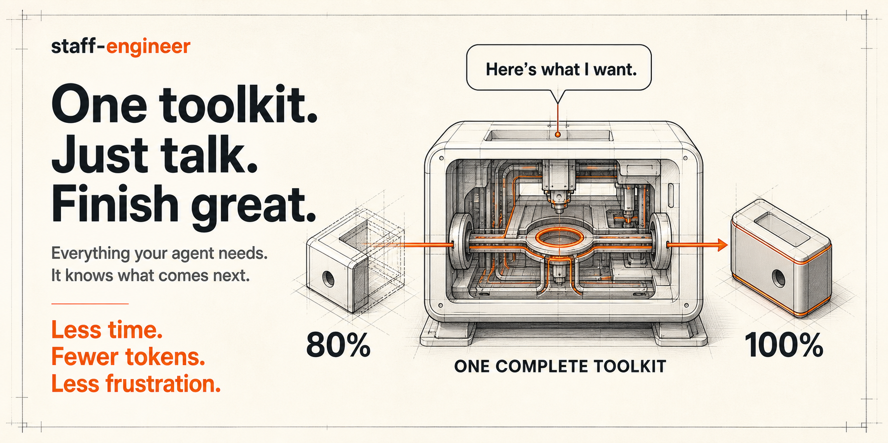
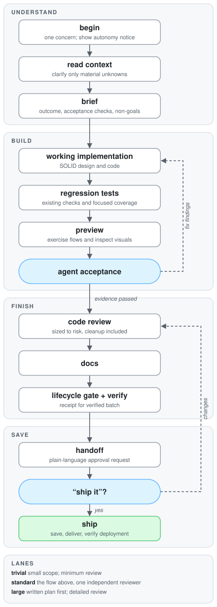

# Staff Engineer for AI Agents



**Turn your AI coding agent into a staff engineer you can trust with your product.**

A drop-in toolkit for Claude Code, Codex, Kimi, Pi, OpenCode, Cursor, and any other coding agent.
By default, the agent builds, exercises and visually inspects the working result, reviews its
code, and runs your project's checks before asking once for final approval. You can ask for
check-ins along the way or authorize it to handle delivery too. You never type a command;
the agent drives everything. Any language or framework, no dependencies, installed by the agent itself:

```text
"install https://github.com/kleber-maia/skill-staff-engineer into this project"
```

## Choose how much to delegate

**Final approval is the default for new installations and existing installations
when they upgrade.** An explicitly remembered mode is preserved.

| Mode | What the agent does | When it asks you |
| --- | --- | --- |
| **Guided** | Builds a working preview, then reviews and runs the final checks after you accept it | Along the way and before saving; small fixes combine those approvals |
| **Final approval — default** | Builds, exercises the result, inspects affected visuals, reviews, fixes problems, and runs the final checks | Once the finished result is ready to ship |
| **Through delivery** | Performs the same verification, then saves, delivers, and verifies any configured deployment | Only for a material decision, missing authority, or a blocker it cannot resolve |

Every task starts with a prominent reminder of the active mode and how to steer:

> **Autonomy: Guided** · Say “handle it” for fewer check-ins.

> **Autonomy: Final approval** · I’ll verify, then ask before shipping. Say “ship when ready” or “walk me through it” to switch.

> **Autonomy: Through delivery** · I’ll verify and ship. Say “ask before shipping” or “hold” anytime.

When deployment is configured, the notice names its destination, such as
**Through delivery → staging**. The agent shows an updated notice when you switch modes.

### Change course by talking

No skill invocation, arguments, or settings file to learn. The agent handles the change:

| Say something like | What changes |
| --- | --- |
| “Walk me through this one.” | Guided mode for this task |
| “Handle it; bring me the finished result.” | Final approval for this task |
| “Ship when ready.” | Through delivery for this task, within the established destination |
| “Ask before shipping.” | Final approval for the current task, even if delivery was previously delegated |
| “Hold.” | Pauses further actions |
| “Continue.” | Resumes the task in its selected mode |
| “From now on, bring me the finished result for approval.” | Remembers Final approval as this project's default on this checkout |

Without “from now on” or “remember this”, the change applies only to the current
task. Remembered preferences survive chats and upgrades on this checkout; they are
not shared with other machines or operators. Praise and silence never increase
autonomy. A pause takes effect before the next action; it cannot undo a completed
action or necessarily interrupt an external command already running.

The agent asks about your preference once during installation. It does not ask you
to choose again at the start of every task. You can steer whenever you need to.

### Verification and cost

Final approval and Through delivery require the agent to exercise acceptance
criteria and inspect affected visuals itself. A passing test suite, a reachable
page, or an uninspected screenshot is not enough. If a required capability is
unavailable, the agent resolves or reports that blocker instead of claiming success.

Guided mode keeps the earlier approach of involving you in preview acceptance and
offers lighter agent self-checks when you prefer to spend less. Every mode retains
the required code review, project checks, and guarded save. Unchanged test receipts,
probes, and delta reviews reduce repeated work; autonomy changes the check-ins,
not the engineering requirements.

## The last 20 percent

A great model gets you to 80 percent of great software astonishingly fast. The last 20 percent is
judgment, and left alone, even the best agent behaves like a talented junior in their first week:

- **It starts typing before it understands**, and you find the wrong guess after the code exists.
- **It calls it done when the tests pass.** Nobody exercised the actual result.
- **It misses things**: the edge case, the caller it broke, the requirement it forgot.
- **It leaves a mess**: debug output, suppressed warnings, three unrelated fixes in one commit.
- **It speaks engineer**, so you cannot judge whether the news is good.
- **It forgets.** Rules fade as the chat grows, and every new chat starts from zero.

None of this is a model problem. It is a process problem, and process needs durable checks, not
reminders. staff-engineer packages that judgment as skills the agent reads and a small CLI that
refuses to skip the steps that matter.

## Discipline is cheaper than disorder

Skipping steps feels fast until the bill arrives. Disorder costs time, money, or both:

- a feature rebuilt because nobody asked what was actually wanted;
- a fix that quietly breaks another screen and is found by a customer;
- a bug that comes back because nothing proved it was gone;
- a change nobody can undo cleanly because three things were saved together;
- hours of an expensive engineer untangling code no one dares to touch.

And depending on what the software does, it can be far worse than wasted time: a customer charged
twice, records deleted or leaked, an account opened to the wrong person, a medical or financial
number that is quietly wrong. Those are not bugs you fix on Monday; they cost trust, money, and
sometimes much more.

Preventing that is the whole reason this toolkit exists. The second goal is to do it without
waste: the extra care is paid once, only where the risk is, and as much of it as possible is done
by plain code rather than by the model, so agents and tokens are spent on judgment, not on
repeating themselves.

## What changes

| Before | After |
|---|---|
| The agent guesses at what you meant | It reads existing context, records the brief, and asks only about material unresolved decisions |
| "Done" means the tests pass | The agent exercises acceptance criteria, inspects affected visuals, reviews the code, and verifies delivery |
| Bugs, regressions, and missed requirements slip through | Every code change gets a review sized to its risk, from a quick self-check to several independent reviewers |
| A fixed bug comes back | A bug fix is saved only with a test that fails without the fix and passes with it |
| Debug lines, `TODO`s, `any`, oversized files slip in | A gate refuses them, in ten languages, before anything is saved |
| Unrelated changes ride along | One change, one commit; work that was already pending is kept out |
| Status reports are full of jargon | Every message to you is plain language |
| Praise for a screen is taken as a green light | Delivery follows explicit final approval or the autonomy mode you selected |
| Every request pays the same process cost | A typo gets a small review; a payments change gets a detailed review. Your selected mode controls check-ins |
| Every chat starts from zero | It remembers your decisions, known weak spots, and what worked (below) |

## It remembers

The agent's memory lives in the project, so it survives new chats and agents using
the same checkout. Committed decisions and known issues also travel to other machines;
task state and personal preferences stay local.

- **Where you left off.** The current piece of work, its agreed outcome, and its step are kept in
  the project. Come back a week later and the agent continues exactly there.
- **Your decisions.** Every choice you settle ("export as CSV", "no scheduled emails") is saved with
  the change. Before asking you anything new, the agent sees the decisions that apply, so you are
  never asked twice. Committed, so teammates and other agents inherit them.
- **Known weak spots.** Problems a review found but left for later are saved with the files they
  affect. When later work touches those files, the agent sees them and can fix them while it is
  there, and it tells you when a weak spot remains near a change.
- **What works.** A private history on your machine tells the agent when changes keep needing
  extra rounds, a rule keeps getting waived, or a saved change was later undone, so it adjusts, and
  every tenth save you hear, in one line, how often things were right the first time.

## A session, from your seat

You: *“Customers should be able to export their order history as CSV for chosen dates.”*

The agent displays the autonomy notice, reads the project conventions, records the
brief, and builds. It exports orders itself, inspects the interface at appropriate
screen sizes, reviews the code, fixes problems, and runs the final checks. Then:

> **What changed:** customers can export their order history as CSV for chosen dates.
> **What was checked:** I exported orders, inspected the desktop and mobile results,
> completed the code review, and ran the automated checks and build.
> **Is this finished and approved to save?**

You approve in your own words. The agent saves and confirms delivery. In Through
delivery mode it continues without that question, then reports the verified result.

## Who it is for

- **Founders and operators without an engineering background** who run their product through an
  agent and want to approve outcomes, not read diffs.
- **Engineers using agents daily** who are tired of reviewing sloppy, unreviewed changes.
- **Teams mixing agents and people**: every agent reads the same contract from `AGENTS.md` and
  produces commits with the same shape.

## How it works

<p align="center">
  <picture>
    <source media="(prefers-color-scheme: dark)" srcset="docs/lifecycle-dark.svg">
    
  </picture>
</p>

- **Understand.** Open one concern, display its autonomy mode, read context, and record
  the outcome and acceptance criteria. Clarify material unknowns.
- **Build and inspect.** Implement the smallest complete solution with useful tests.
  For bugs, prove failure before the fix. Exercise the working preview and inspect
  affected visuals; record evidence for every acceptance criterion.
- **Finish.** Review at the required level, fix findings, update docs, and run the
  lifecycle gate and full checks. Changed work invalidates relevant evidence.
- **Deliver.** Present one handoff for final approval, or continue under the chosen
  autonomous mode. Confirm Git delivery and any configured deployment.

Each step is a CLI command the agent runs; `next` determines the next step and
whether to wait. Guided mode preserves the earlier preview-acceptance workflow.
Lanes control scope and review depth independently of autonomy.

**Done includes delivery.** Once authorized, the agent commits the verified batch
and confirms its push to the project's remote before reporting completion. Commit
and push form one logical operation: a failed push leaves delivery pending, and
retrying sends the same commit. Final approval means “ready for your approval”
before that operation, not “done”. If deployment is configured, completion also
requires verifying the delivered revision is live. Explicit local-only work is
reported as local, never as pushed.

<details>
<summary><strong>Under the hood</strong> (you do not need to read this)</summary>

- **Eleven skills** the agent reads on its own: the operating contract, the interview, SOLID, the
  risk-sized code review, the four cleanup lenses, UI finish, architecture boundaries, data safety,
  spec and plan, the handoff, and the installer.
- **A staged-diff gate** for debug output, suppressions, loose types, and unfinished markers in
  JavaScript/TypeScript, Python, Go, Rust, Ruby, Java/Kotlin, Swift, PHP, C#, and shell; UI finish
  rules; import boundaries; test-quality guards; docs and test coverage per batch. Every rule can
  be disabled or given a justified exception.
- **Reviews that cost what the risk warrants**: one packet (brief, diff, callers, tests, known
  issues) so reviewers never crawl the repository, delta-only re-reviews, and findings that need
  `file:line` evidence and a concrete failure.
- **Receipts instead of reruns**: the full check runs once per batch; the receipt proves it ran on
  exactly the code being saved. Free preview probes and bug reproductions run in the CLI, not the
  model.
- **Self-updating**: at most once a day, a newer toolkit is saved as its own change before work
  starts. Installing and updating the toolkit never go through the workflow themselves.
- **A Claude Code plugin** with slash commands, review subagents, and hooks that keep the next step
  in view, check approvals against what you actually typed, deny dangerous commands, and protect
  secrets.
- **Zero dependencies.** Node.js 20+ and git are all a project needs.

</details>

## Install

Point your agent at this repository and say **"install https://github.com/kleber-maia/skill-staff-engineer into this project"**. The
agent follows [AGENTS.md](AGENTS.md): dry run, install, then a short question loop to confirm how
your project is checked and started, plus one question about your preferred autonomy
mode. The agent records your answer; you do not run a command to select it. Use a tag from the
[published releases](https://github.com/kleber-maia/skill-staff-engineer/releases), replacing
`<released-version>` below with that version. Or do it yourself:

```bash
git clone --branch v<released-version> --depth 1 https://github.com/kleber-maia/skill-staff-engineer ~/staff-engineer
cd your-project
node ~/staff-engineer/scripts/cli.mjs install --target . --dry-run   # review the plan
node ~/staff-engineer/scripts/cli.mjs install --target . --yes
node .staff-engineer/cli.mjs doctor                                   # answer its questions
```

Claude Code 2.1.224+ users can also add the plugin for slash commands, subagents, and hooks.
The marketplace downloads the latest published release ZIP:

```bash
claude plugin marketplace add kleber-maia/skill-staff-engineer
claude plugin install staff-engineer@staff-engineer
# inside a project:  /staff-engineer:install
```

<details>
<summary><strong>What lands in your project</strong></summary>

```
.staff-engineer/        vendored CLI, rules, templates, config.json, exceptions.json,
                        and the committed memory: decisions.json, known-issues.json
.agents/skills/         the eleven skills, discovered by Claude Code, Codex, Cursor, and others
AGENTS.md               a managed block with the contract; your own text is untouched
CLAUDE.md               "@AGENTS.md" (created only if missing)
.gitignore              a managed block for toolkit backups
.claude/settings.json   hook entries, only with --with-claude-hooks (the plugin brings its own)
```

Detection fills `config.json` for Node, Python, Go, Rust, Ruby, Java/Kotlin, Swift, PHP,
Makefiles, and static sites; anything it cannot infer becomes a plain-language question the agent
asks you. Session state, receipts, review packets, screenshots, logs, operator messages, local
settings, and the insight history live under `.git/staff-engineer/`, never in history. Decisions
and known issues are the only toolkit data that is committed, because they belong to the project. Rerunning `install` upgrades only toolkit-owned files; `install --uninstall` removes them.

Every option, with its default and meaning, is described in
[schemas/config.schema.json](schemas/config.schema.json); per-machine preferences are listed by
`node .staff-engineer/cli.mjs settings`. Autonomy is managed by conversation and
recorded with `autonomy`; the new default also applies to existing installs. Other
compatible preferences are preserved, and
[CHANGELOG.md](CHANGELOG.md) marks anything that changes behavior.

Automatic updates follow **published stable GitHub releases**, not pushes to `main`. A push
does not publish a release. The agent asks the maintainer after every push, and the manual
[release workflow](docs/releases.md) checks the approved version and exact commit before
publishing. Existing installations need the transition update described there.

Saving to a project with a remote includes delivery automatically. A failed push
keeps the concern pending: the agent retries the same commit with `ship --sync-only`,
and reports completion after confirmed delivery. Projects without a remote stay local;
`shipping.mode: "local"` explicitly selects local work even when a remote exists.
Optional `shipping.remote` and `shipping.branch` select one destination.
`shipping.timeoutMs` bounds each network command. Toolkit maintenance follows the
same guarantee and retries with `save-toolkit`.

For deployment, the agent configures the `deployment` object with `environment`,
`cmd`, `verifyCmd`, and `timeoutMs` from your project conventions and authorized
destination. It asks only if that destination is ambiguous. The verification command must confirm `STAFF_ENGINEER_COMMIT` is live
and smoke checks pass. `ship` then leaves deployment pending until `deploy` verifies
it. See [the autonomy contract](skills/staff-engineer/autonomy.md) for recovery and
push-triggered deployments. No deployment provider or browser dependency is bundled.

### Trust boundary

staff-engineer is a cooperative workflow, not a security sandbox. The vendored CLI can enforce the
rules of commands that pass through it: session transitions, protected staged batches, immutable
verification inputs, receipts, review records, approvals, and guarded commits. Claude Code hooks are optional,
harness-specific, and deliberately fail open if they break. Other agents follow the installed
skills and `AGENTS.md`; they are not technically prevented from invoking git directly. The default
`rules.requireSession: "warn"` also reports skipped session discipline without blocking standalone
lifecycle use; set it to `"block"` when the project wants the CLI gate to require a finalized
session and current context packet. When required by the selected mode, approvals are the operator's quoted words: in Claude Code they
are checked against messages the hook recorded, elsewhere they are trusted as reported, and every
commit says which (`Approval-Evidence`). They are an audit trail, not authentication. Likewise,
the CLI can require and record review and visual evidence, but cannot prove what
the agent actually perceived. Autonomous commits record mode authorization separately
from operator approval.

For the curious: [docs/lifecycle.md](docs/lifecycle.md) walks through every step and what it
refuses, [docs/design.md](docs/design.md) explains why, and [docs/faq.md](docs/faq.md) answers the
usual questions. `npm test` runs the toolkit's own tests.

</details>

## License

MIT
